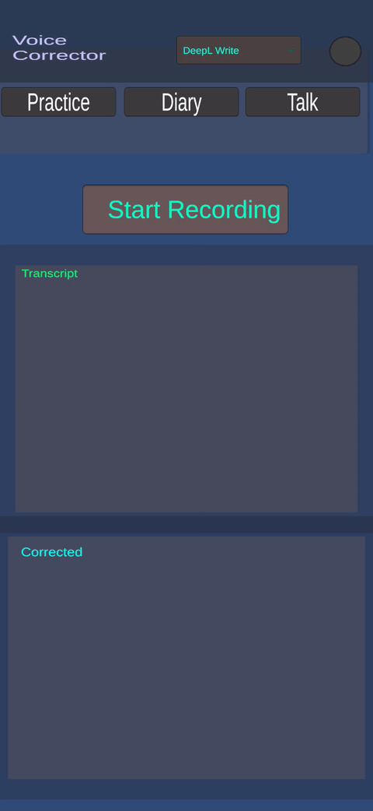
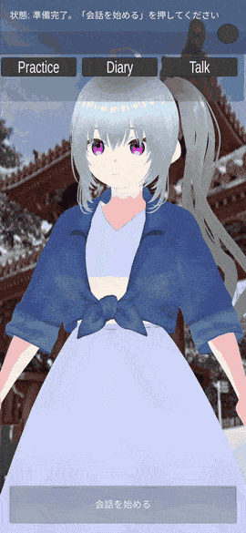

# Voice English Corrector（英語音声添削アプリ）

スマホに向かって英語で話すと、文字起こしして **Gemini API** または **DeepL Write API** で自然な英語に添削してくれる、Unity 製の英語学習アプリです。
話した内容を英語日記として残して連続記録（ストリーク）をつけたり、3D キャラクターと英語で会話したりもできます。

| 添削（Practice） | 3D キャラとの会話（Talk・実験中） |
|---|---|
|  |  |

## 主な機能

アプリは3つの画面に分かれています。

### Practice：英語の添削
- 録音ボタンで話し始め、もう一度押すと停止して添削
- **文字起こし**：端末内蔵の音声認識（Android: SpeechRecognizer / iOS: SFSpeechRecognizer）。使えない環境（Unity Editor など）では録音した WAV を Gemini で文字起こし
- **添削エンジンの切り替え**
  - Gemini：文法の修正と、なぜ直したかの解説
  - DeepL Write：より自然な言い回しへの言い換え

### Diary：英語日記
- 停止ボタンを押すまで話し続けられる（音声認識が途中で切れても自動で再開）
- 話し終わったら、日記全体をまとめて添削
- **連続記録（ストリーク）**：日記を書いた日数と、今週の達成状況を表示
- **ログイン・クラウド保存**（任意）：Supabase でログインすると、記録と日記をクラウドに保存（Web 版と共通）
- **Discord 連携**（任意）：添削した日記を Discord に送信。元の文から直した単語には下線を付ける
- **リマインダー**（任意）：夜までに日記を書いていないと Discord に通知

### Talk：3D キャラクターとの英会話（実験中）
- VRM キャラクターと音声で会話（LLM は LLMUnity でスマホの中で動かす）
- 返事は1文できるたびに読み上げ、口パク・うなずき・表情も付く
- キャラクターをタッチすると反応する
- 現在は Android のみ対応

## 動作環境

| 項目 | 内容 |
|---|---|
| Unity | 2022.3.62f3 |
| 対象 OS | Android（iOS 向けのコードもあるが未検証） |
| 言語 | C# |
| 主なパッケージ | TextMeshPro、[UniVRM](https://github.com/vrm-c/UniVRM)、[LLMUnity](https://github.com/undreamai/LLMUnity) |

## セットアップ

1. このリポジトリをクローンします。
   ```
   git clone https://github.com/haru452/Learningapp.git
   ```
2. Unity Hub で **Unity 2022.3.62f3** を使ってフォルダを開きます。
   初回は `Library/` の生成やパッケージのダウンロードに時間がかかります。
3. LLMUnity のライブラリ（`Assets/StreamingAssets/LlamaLib-*`）はサイズが大きいため、リポジトリには含めていません。Unity でプロジェクトを開くと LLMUnity が自動でダウンロードします。
4. Talk 画面を使う場合は、LLMUnity の `LLM` コンポーネントで使う AI モデル（`.gguf`）をダウンロードして設定してください。モデルもサイズが大きいため、リポジトリには含めていません。
5. `Assets/Scenes/SampleScene.unity` を開きます。
6. 下の「API キーの設定」に従ってキーを入力し、再生（Play）します。

## API キーの設定

API キーは **`Assets/Resources/ApiSecrets.json`** に書きます。このファイルは `.gitignore` で除外しているので、GitHub には上がりません。

1. リポジトリ直下の `ApiSecrets.example.json` を `Assets/Resources/ApiSecrets.json` にコピーします。
2. 必要なキーを書き込みます。

```json
{
  "geminiApiKey": "ここに Gemini のキー",
  "deeplApiKey": "ここに DeepL のキー",
  "discordWebhookUrl": "",
  "discordBotToken": "",
  "discordChannelId": "",
  "reminderWorkerUrl": "",
  "reminderSecret": "",
  "supabaseUrl": "",
  "supabaseAnonKey": ""
}
```

| 項目 | 取得先 | 必須 |
|---|---|---|
| geminiApiKey | [Google AI Studio](https://aistudio.google.com/apikey) | ✅ |
| deeplApiKey | [DeepL API](https://www.deepl.com/pro-api) | DeepL Write を使う場合 |
| supabaseUrl / supabaseAnonKey | [Supabase](https://supabase.com/) | ログイン・日記保存を使う場合 |
| discordWebhookUrl | Discord のサーバー設定 | 任意 |
| reminderWorkerUrl / reminderSecret | 自前のリマインダー用 Worker | 任意 |

> ⚠️ **注意**
> - キーは Inspector に入力しないでください。Inspector の値はシーンファイル（`.unity`）に保存され、コミットすると GitHub に公開されてしまいます。
> - `ApiSecrets.json` はビルドしたアプリ（APK など）の中には含まれます。キー入りのビルドは公開しないでください。

## 関連リポジトリ

このアプリが使うサーバー側のコードは、別のリポジトリで管理しています。

| リポジトリ | 内容 |
|---|---|
| [my-project-connected-to-discord](https://github.com/haru452/my-project-connected-to-discord) | Cloudflare Workers のコード（日記のリマインダー・Discord 通知）。毎日の実行は [cron-job.org](https://cron-job.org/en/) から呼び出し |
| [database_learnApp](https://github.com/haru452/database_learnApp) | データベース（Supabase）のコードと Web 版 |

## スクリプト構成

```
Assets/Script/
├── CorrectionDiary/
│   ├── AppManager.cs            … 録音 → 文字起こし → 添削 → 表示 の全体制御
│   ├── DiaryManager.cs          … 日記モードの制御
│   ├── AudioRecorder.cs         … マイク録音と WAV 変換
│   ├── NativeSpeechRecognizer.cs… 端末内蔵の音声認識ラッパー
│   ├── GeminiApiClient.cs       … Gemini API（文字起こし・添削）
│   ├── DeepLApiClient.cs        … DeepL Write API（言い換え）
│   ├── TextDiff.cs              … 原文と添削後の差分計算
│   ├── DiaryStreakTracker.cs / DiaryStreakView.cs … 連続記録
│   ├── SupabaseService.cs / AuthPanel.cs / LoginGate.cs … ログイン・データ保存
│   ├── ReminderClient.cs        … リマインダー Worker への通知
│   ├── ApiSecrets.cs            … API キーの読み込み
│   └── HttpUtil.cs              … 通信の共通処理
├── Talk3D/                      … 3D キャラクターとの会話（実験中）
├── SpeechRecognizerBridge.mm    … iOS 用音声認識ブリッジ
└── AndroidManifest.xml          … マイク権限など
```

内部の仕組みは [`docs/TECHNICAL.md`](docs/TECHNICAL.md)、もともとの要件は [`Assets/prd.md`](Assets/prd.md) を参照してください。

## ビルド

- **Android**：File → Build Settings → Android を選んで Build。マイクの権限が必要です。
- **iOS**：iOS を選んで Build します。`Info.plist` へのマイク・音声認識の利用目的の追加と `Speech.framework` のリンクは、`Assets/Editor/IosPostBuild.cs` がビルド後に自動で行います（iOS 実機では未検証）。

## 注意

- 次のものは `.gitignore` で除外しています：`Library/`、`Temp/`、`Build/`、LLMUnity のライブラリ、`*.gguf`（AI モデル）
- GitHub は 100MB を超えるファイルを受け付けません。大きいファイルを追加するときは注意してください。

## ライセンス

このプロジェクトのコードは [MIT License](LICENSE) で公開しています。

ただし、次のものは MIT License の対象外です。それぞれの利用条件に従ってください。

- `Assets/My assets/amanogawa.vrm`：VRM モデルの中に書き込まれた利用条件（再配布・改変は不可）
- `Packages/` 内のパッケージ（UniVRM など）、TextMesh Pro、LLMUnity：各パッケージのライセンス
