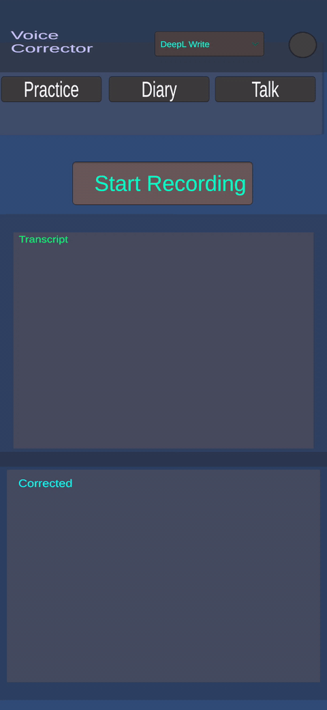
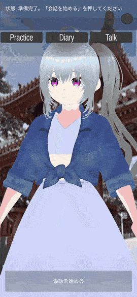

# Voice English Corrector（英語音声添削アプリ）

スマホに向かって英語で話すと、文字起こしして **Gemini API** または **DeepL Write API** で自然な英語に添削してくれる、Unity 製の英語学習アプリです。
話した内容を英語日記として残して連続記録（ストリーク）をつけたり、YouTube の英語動画を要約するスピーキング練習（Versant 対策）をしたり、3D キャラクターと英語で会話したりもできます。

> このリポジトリは、[Learningapp](https://github.com/haru452/Learningapp)（記事「その１」の時点のコード）の続きです。
> 「その１」からの主な変更：
> - **Summary 画面を追加**：YouTube の短い英語動画を見て、制限時間内に話して要約し、Gemini が採点する（Versant 対策）
> - 3D キャラクターが、返事の感情に合わせて表情を変えるようにした
> - 3D キャラクターのタッチ反応を削除した

📝 **解説記事（Qiita）**：[その１：Unity で「話した英語を AI が添削してくれる」英語日記アプリを作った](https://qiita.com/haru452/items/8656d7d15db5d20c7b41)

| 添削（Practice） | 3D キャラとの会話（Talk・実験中） |
|---|---|
|  |  |

## 主な機能

アプリは4つの画面に分かれています。

### Practice：英語の添削
- 録音ボタンで話し始め、もう一度押すと停止して添削
- **文字起こし**：端末内蔵の音声認識（Android: SpeechRecognizer / iOS: SFSpeechRecognizer）。使えない環境（Unity Editor など）では録音した WAV を Gemini で文字起こし
- **添削エンジンの切り替え**
  - Gemini：文法の修正と、なぜ直したかの解説
  - DeepL Write：より自然な言い回しへの言い換え

### Diary：英語日記
- 停止ボタンを押すまで話し続けられる（音声認識が途中で切れても自動で再開）
- 話し終わったら、日記全体をまとめて添削
- **連続記録（ストリーク）**：日記を書いた日数と、今週の達成状況を表示
- **ログイン・クラウド保存**（任意）：Supabase でログインすると、記録と日記をクラウドに保存（Web 版と共通）
- **Discord 連携**（任意）：添削した日記を Discord に送信。元の文から直した単語には下線を付ける
- **リマインダー**（任意）：夜までに日記を書いていないと Discord に通知

### Summary：動画の要約練習（Versant 対策）
- YouTube Data API で、字幕付きの短い英語動画（40秒〜2分半）を毎回ランダムに出題
- 動画はアプリ内の埋め込みプレーヤーで再生（Editor ではブラウザで開く）
- 動画が終わると制限時間（標準60秒）のカウントダウンが始まり、話して要約する
- Gemini が動画そのものを見て、項目ごとに採点：内容（50点）・構成（25点）・文法・語彙（25点）。合計はアプリで計算
- あわせて、押さえた点・抜けた点・文法の指摘・お手本の要約・改善例も表示
- 採点結果は Discord に送信（任意。項目ごとの点数を棒グラフ風に表示）。ログイン中はクラウドに保存され、Web 版で点数の推移と項目ごとの内訳をグラフで見られる
- 音声認識が途中で切れても、日記モードと同じく自動で再開する
- YouTube Data API の無料枠は 1 日 10,000 ユニットで、動画の検索 1 回に 100 ユニット使う（1 日に約 100 回まで出題できる）
- Summary 画面は、Unity のメニュー **Tools → Summary Practice → Create Summary Screen** で、今のシーンに自動で組み立てられる（`Assets/Editor/SummaryScreenBuilder.cs`）

### Repeat：リピーティング（聞いた英文を言い返す）
- 1 回 5 文。英文は見せずに読み上げ、聞き終わったら同じ文を言い返す。言えた単語は緑・抜けた単語は赤で、一致率（%）を出す
- 文の出どころ：前回 80% 未満だった文（最大 2）→ 自分の添削文（日記・要約・お題、直近 30 日、最大 2）→ 残りは [Tatoeba](https://tatoeba.org/) の文
- 声：Tatoeba の文は**本物の人の録音**、自分の添削文は Gemini の音声合成（声 `Leda`）。失敗したときは端末の読み上げ
- **Again** でもう一度、**Slow** で 0.75 倍（アプリの中で引き伸ばすので声の高さは変わらない）
- 録音・作った音声は端末に保存して使い回す（最大 300 個・60 MB）
- 結果はクラウドに保存され、Web 版の「リピーティング」で一致率の推移と苦手な文を見られる。Discord にも送れる（専用のチャンネル）
- Repeat 画面は、Unity のメニュー **Tools → Repeat Practice → Create Repeat Screen** で組み立てる（`Assets/Editor/RepeatScreenBuilder.cs`）

#### Tatoeba の文を入れる（最初に 1 回だけ）
Tatoeba のデータは**著作権のため git に入れていません**（`.gitignore` 済み）。各自のパソコンで作ります。

1. [Tatoeba のダウンロードページ](https://tatoeba.org/en/downloads) から次の 2 つを取ってきて、`Tools~/tatoeba/` に置く
   - `eng_sentences.tsv.bz2`（Sentences → English）
   - `sentences_with_audio.tar.bz2`
2. 変換スクリプトで 1,000 文を選ぶ（`Assets/Resources/RepeatSentences.json` ができる）
   ```
   cd Tools~/tatoeba
   python3 build_repeat_sentences.py --sentences eng_sentences.tsv.bz2 --audio sentences_with_audio.tar.bz2 --out ../../Assets/Resources/RepeatSentences.json --count 1000 --seed 42
   ```
   条件：録音とライセンスがある / 5〜10 語 / Tom・Mary が出てくる文は 15% まで（テスト：`python3 -m unittest test_build_repeat_sentences`）
3. 録音は、練習で流すときにアプリが Tatoeba からダウンロードする

> ⚠️ 文は CC BY 2.0 FR、録音は録音した人ごとのライセンス（主に CC BY-NC-ND）です。**個人の学習用（営利目的でない）でだけ**使ってください。アプリを有料で配ったり、録音を加工して配ったりはできません。画面に作者名を表示しています。
> `RepeatSentences.json` が無いときは、自分の添削文と前回言えなかった文だけで練習します。

#### シャドーイング（Repeat 画面の `Shadowing: On`）
ふだん YouTube でシャドーイングしている動画で、最後の確認をする機能。
- 検索欄に動画のタイトルを入れて `Search` → 候補（1〜15 分、最大 5 件）から選ぶ。選んだ動画は覚えておく
- `Start` → 初めての動画だけ、Gemini が YouTube の URL からお手本の文字起こしを作る（スマホに保存、最大 20 本）
- 動画がアプリの中に出るので **▶ を押す**。再生が始まると同時に録音が始まる。最後まで流れると止まる（`Stop` で途中まででも判定）
- 録音を 3 分ずつ Gemini で書き起こし、お手本と照合 → 平均・文ごとの色分けと %・**日本語のアドバイス**（発音・リズム・遅れ）・`My voice`
- **イヤホンを使う**。Android でイヤホンが付いていないときは確認が出る
- クラウド・Web には**点数だけ**（1 回 = 1 行、`mode = 'shadow'`、`source = 'youtube'`）。動画のタイトル・アドバイス・文ごとの結果は Discord にだけ送る
- 動画は YouTube 公式の埋め込みプレーヤーで流すだけで、音声は保存しない。お手本の文字起こしと録音はスマホの中だけ（`persistentDataPath/shadow_scripts/`）。個人の学習用
- キー：シャドーイング専用の `geminiShadowApiKey`（空なら `geminiTtsApiKey`、上限ならほかを借りる）と `youtubeShadowApiKey`（空なら `youtubeApiKey`）。古い Supabase の場合は `supabase/repeat.sql` を実行し直す

### 苦手な発音と「今日の発音練習」
- お題の **Pronunciation check** で、アドバイスと一緒に「どの音の問題か」が出る（`Sound: TH` など。固定 10 種類＋その他）
- 言い直し（お題）とリピーティングで言えなかった単語のつづりからも、苦手な音を数える。リピーティングのまとめに `Watch out: TH, R / L` が出る
- 記録はクラウド（`supabase/sounds.sql`）に保存し、Web の「よくあるミス」ページの「苦手な発音」で見られる（期間ボタン 7 / 30 / 90 日）
- その日最初の練習のあと、30 日で 3 点以上の苦手 1 位の音について、英語ネイティブの練習動画を YouTube で探し、**発音用の Discord チャンネル**（`pronunciationDiscordWebhookUrl`）に 1 日 1 回送る（同じ動画は 30 日送らない）
- 必要なもの：ログイン、`youtubeApiKey`、発音用の Discord。どれか無ければ送らない（練習はそのまま使える）

### Talk：3D キャラクターとの英会話（実験中）
- VRM キャラクターと音声で会話（LLM は LLMUnity でスマホの中で動かす）
- 返事は1文できるたびに読み上げ、口パク・うなずきも付く
- 返事の感情（うれしい・悲しい・驚きなど）に合わせて表情が変わる。ユーザーが悲しい話をすると、考えている間も悲しそうな顔をする
- 現在は Android のみ対応

## 動作環境

| 項目 | 内容 |
|---|---|
| Unity | 2022.3.62f3 |
| 対象 OS | Android（iOS 向けのコードもあるが未検証） |
| 言語 | C# |
| 主なパッケージ | TextMeshPro、[UniVRM](https://github.com/vrm-c/UniVRM)、[LLMUnity](https://github.com/undreamai/LLMUnity)、[unity-webview](https://github.com/gree/unity-webview) |

## セットアップ

1. このリポジトリをクローンします。
   ```
   git clone https://github.com/haru452/Learningapp2.git
   ```
2. Unity Hub で **Unity 2022.3.62f3** を使ってフォルダを開きます。
   初回は `Library/` の生成やパッケージのダウンロードに時間がかかります。
3. LLMUnity のライブラリ（`Assets/StreamingAssets/LlamaLib-*`）はサイズが大きいため、リポジトリには含めていません。Unity でプロジェクトを開くと LLMUnity が自動でダウンロードします。
4. Talk 画面を使う場合は、LLMUnity の `LLM` コンポーネントで使う AI モデル（`.gguf`）をダウンロードして設定してください。モデルもサイズが大きいため、リポジトリには含めていません。
5. `Assets/Scenes/SampleScene.unity` を開きます。
6. 下の「API キーの設定」に従ってキーを入力し、再生（Play）します。

## API キーの設定

API キーは **`Assets/Resources/ApiSecrets.json`** に書きます。このファイルは `.gitignore` で除外しているので、GitHub には上がりません。

1. リポジトリ直下の `ApiSecrets.example.json` を `Assets/Resources/ApiSecrets.json` にコピーします。
2. 必要なキーを書き込みます。

```json
{
  "geminiApiKey": "ここに Gemini のキー",
  "geminiSummaryApiKey": "",
  "geminiTopicApiKey": "",
  "geminiTtsApiKey": "",
  "geminiShadowApiKey": "",
  "deeplApiKey": "ここに DeepL のキー",
  "discordWebhookUrl": "",
  "discordBotToken": "",
  "discordChannelId": "",
  "reminderWorkerUrl": "",
  "reminderSecret": "",
  "supabaseUrl": "",
  "supabaseAnonKey": "",
  "youtubeApiKey": "",
  "youtubeShadowApiKey": "",
  "summaryDiscordWebhookUrl": "",
  "summaryDiscordChannelId": "",
  "pronunciationDiscordWebhookUrl": "",
  "pronunciationDiscordChannelId": "",
  "repeatDiscordWebhookUrl": "",
  "repeatDiscordChannelId": ""
}
```

| 項目 | 取得先 | 必須 |
|---|---|---|
| geminiApiKey | [Google AI Studio](https://aistudio.google.com/apikey) | ✅ |
| geminiSummaryApiKey / geminiTopicApiKey / geminiTtsApiKey / geminiShadowApiKey | Google AI Studio（要約練習・お題・リピーティングの読み上げ・シャドーイング用。**それぞれ別のプロジェクトで作る**と無料枠が増える） | 任意。空なら geminiApiKey。上限になったらほかのキーを借りる |
| deeplApiKey | [DeepL API](https://www.deepl.com/pro-api) | DeepL Write を使う場合 |
| youtubeApiKey | [Google Cloud Console](https://console.cloud.google.com/apis/library/youtube.googleapis.com)（YouTube Data API v3 を有効化） | 要約練習を使う場合 |
| youtubeShadowApiKey | 同上（シャドーイングの動画検索用。別のプロジェクトで作ると上限が分かれる） | 任意。空なら youtubeApiKey |
| supabaseUrl / supabaseAnonKey | [Supabase](https://supabase.com/) | ログイン・日記保存を使う場合 |
| discordWebhookUrl | Discord のサーバー設定 | 任意 |
| summaryDiscordWebhookUrl | Discord のサーバー設定（要約練習の結果を送るチャンネルの Webhook。日記とは別） | 任意。空なら要約の結果は送らない |
| pronunciationDiscordWebhookUrl | Discord（お題の発音チェックのアドバイスを送るチャンネル） | 任意 |
| repeatDiscordWebhookUrl | Discord（リピーティングの結果を送るチャンネル） | 任意 |
| reminderWorkerUrl / reminderSecret | 自前のリマインダー用 Worker | 任意 |

> ⚠️ **注意**
> - キーは Inspector に入力しないでください。Inspector の値はシーンファイル（`.unity`）に保存され、コミットすると GitHub に公開されてしまいます。
> - `ApiSecrets.json` はビルドしたアプリ（APK など）の中には含まれます。キー入りのビルドは公開しないでください。

## 関連リポジトリ

このアプリが使うサーバー側のコードは、別のリポジトリで管理しています。

| リポジトリ | 内容 |
|---|---|
| [my-project-connected-to-discord](https://github.com/haru452/my-project-connected-to-discord) | Cloudflare Workers のコード（日記のリマインダー・Discord 通知）。毎日の実行は [cron-job.org](https://cron-job.org/en/) から呼び出し |
| [database_learnApp](https://github.com/haru452/database_learnApp) | データベース（Supabase）のコードと Web 版 |

## スクリプト構成

```
Assets/Script/
├── CorrectionDiary/
│   ├── AppManager.cs            … 録音 → 文字起こし → 添削 → 表示 の全体制御
│   ├── DiaryManager.cs          … 日記モードの制御
│   ├── SummaryPracticeManager.cs… 動画の要約練習（Versant 対策）の制御
│   ├── YouTubeSearchClient.cs   … YouTube Data API で短い動画を検索
│   ├── YouTubePlayerView.cs     … YouTube をアプリ内（WebView）で再生
│   ├── AudioRecorder.cs         … マイク録音と WAV 変換
│   ├── NativeSpeechRecognizer.cs… 端末内蔵の音声認識ラッパー
│   ├── GeminiApiClient.cs       … Gemini API（文字起こし・添削・要約の採点）
│   ├── DeepLApiClient.cs        … DeepL Write API（言い換え）
│   ├── TextDiff.cs              … 原文と添削後の差分計算
│   ├── DiaryStreakTracker.cs / DiaryStreakView.cs … 連続記録
│   ├── SupabaseService.cs / AuthPanel.cs / LoginGate.cs … ログイン・データ保存
│   ├── ReminderClient.cs        … リマインダー Worker への通知
│   ├── ApiSecrets.cs            … API キーの読み込み
│   └── HttpUtil.cs              … 通信の共通処理
├── Talk3D/                      … 3D キャラクターとの会話（実験中）
├── SpeechRecognizerBridge.mm    … iOS 用音声認識ブリッジ
└── AndroidManifest.xml          … マイク権限など
```

内部の仕組みは [`docs/TECHNICAL.md`](docs/TECHNICAL.md)、もともとの要件は [`Assets/prd.md`](Assets/prd.md) を参照してください。

## ビルド

- **Android**：File → Build Settings → Android を選んで Build。マイクの権限が必要です。
- **iOS**：iOS を選んで Build します。`Info.plist` へのマイク・音声認識の利用目的の追加と `Speech.framework` のリンクは、`Assets/Editor/IosPostBuild.cs` がビルド後に自動で行います（iOS 実機では未検証）。

## 注意

- 次のものは `.gitignore` で除外しています：`Library/`、`Temp/`、`Build/`、LLMUnity のライブラリ、`*.gguf`（AI モデル）
- GitHub は 100MB を超えるファイルを受け付けません。大きいファイルを追加するときは注意してください。

## ライセンス

このプロジェクトのコードは [MIT License](LICENSE) で公開しています。

ただし、次のものは MIT License の対象外です。それぞれの利用条件に従ってください。

- `Assets/My assets/amanogawa.vrm`：VRM モデルの中に書き込まれた利用条件（再配布・改変は不可）
- `Packages/` 内のパッケージ（UniVRM など）、TextMesh Pro、LLMUnity：各パッケージのライセンス


メモ
i use　claude opus and it can create ui for me, so i dont have to aligne it...