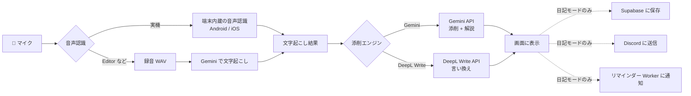
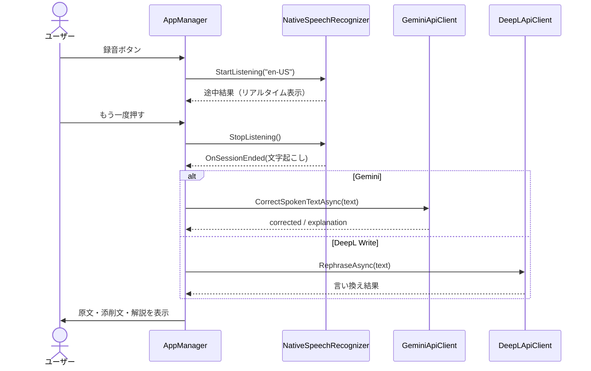
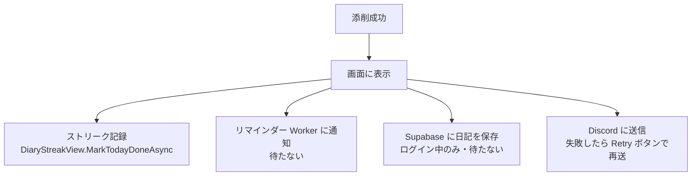
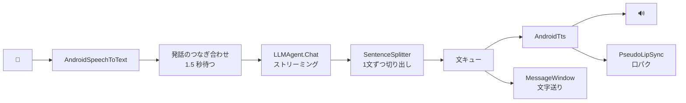
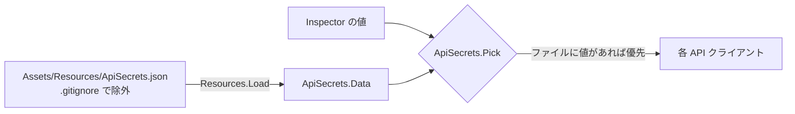

# テクニカルドキュメント

Voice English Corrector（英語音声添削アプリ）の内部構成をまとめた開発者向けドキュメントです。
使い方・セットアップは [README](../README.md)、もともとの要件は [`Assets/prd.md`](../Assets/prd.md) を参照してください。

## 目次

1. [全体像](#1-全体像)
2. [動作環境と依存関係](#2-動作環境と依存関係)
3. [ディレクトリ構成](#3-ディレクトリ構成)
4. [添削モード（AppManager）](#4-添削モードappmanager)
5. [日記モード（DiaryManager）](#5-日記モードdiarymanager)
6. [音声入力](#6-音声入力)
7. [外部 API との通信](#7-外部-api-との通信)
8. [連続記録（ストリーク）](#8-連続記録ストリーク)
9. [3D キャラクター会話（Talk3D・実験中）](#9-3d-キャラクター会話talk3d実験中)
10. [API キーの管理](#10-api-キーの管理)
11. [データの保存先](#11-データの保存先)
12. [ビルド時の設定](#12-ビルド時の設定)
13. [エラー処理の方針](#13-エラー処理の方針)
14. [既知の制約と今後の課題](#14-既知の制約と今後の課題)

---

## 1. 全体像

アプリは大きく3つの機能でできています。

| 機能 | メインのスクリプト | 内容 |
|---|---|---|
| 添削モード | `AppManager` | 短い英文を話す → 文字起こし → 添削して表示 |
| 日記モード | `DiaryManager` | 長めの日記を話す → まとめて添削 → 保存・通知・ストリーク記録 |
| 3D キャラ会話（実験中） | `ConversationController` | VRM キャラクターと端末内 LLM で音声会話 |



---

## 2. 動作環境と依存関係

| 項目 | 内容 |
|---|---|
| Unity | 2022.3.62f3 |
| 対象 OS | Android / iOS（Editor でも動作確認可能） |
| 言語 | C#（iOS の音声認識のみ Objective-C++） |
| UI | uGUI + TextMesh Pro（Talk3D のテスト画面は OnGUI） |
| JSON | `JsonUtility`（リクエストは文字列で組み立て） |
| 通信 | `UnityWebRequest` を async/await で包んだ `HttpUtil` |

**主なパッケージ**

| パッケージ | 用途 |
|---|---|
| UniVRM（`com.vrmc.vrm` / `com.vrmc.gltf`） | VRM 1.0 キャラクターの読み込み・表情・ボーン操作 |
| [LLMUnity](https://github.com/undreamai/LLMUnity)（`ai.undream.llm`） | 端末内で LLM を動かす（Talk3D で使用） |
| TextMesh Pro | テキスト表示 |

**外部サービス**

| サービス | 用途 | 必須 |
|---|---|---|
| Gemini API | 添削・解説、音声の文字起こし（フォールバック時） | ✅ |
| DeepL Write API | 自然な言い回しへの言い換え | DeepL を使う場合 |
| Supabase | ログイン、ストリークと日記のクラウド保存 | 任意 |
| Discord（Webhook / Bot） | 添削した日記の送信 | 任意 |
| リマインダー Worker | 日記を書いていない日に通知 | 任意 |

> サーバー側のコードは、次のリポジトリで管理しています。
> - Cloudflare Workers（リマインダー・Discord 通知）：[my-project-connected-to-discord](https://github.com/haru452/my-project-connected-to-discord)
> - データベース（Supabase のテーブル・関数定義）と Web 版：[database_learnApp](https://github.com/haru452/database_learnApp)

---

## 3. ディレクトリ構成

```
Assets/
├── Script/
│   ├── CorrectionDiary/         … 添削モード・日記モード（メイン機能）
│   ├── Talk3D/                  … 3D キャラクター会話（実験中）
│   ├── SpeechRecognizerBridge.mm… iOS の音声認識（SFSpeechRecognizer）
│   └── AndroidManifest.xml      … マイク権限・音声認識サービスの検出設定
├── Editor/
│   └── IosPostBuild.cs          … iOS ビルド後に Info.plist などを自動設定
├── Resources/
│   └── ApiSecrets.json          … API キー（.gitignore で除外）
├── Scenes/SampleScene.unity     … メインシーン
├── My assets/                   … VRM モデル・画像
└── StreamingAssets/LlamaLib-*   … LLMUnity のライブラリ（.gitignore で除外・自動ダウンロード）
```

### スクリプト一覧

**CorrectionDiary（メイン機能）**

| ファイル | 役割 |
|---|---|
| `AppManager.cs` | 添削モードの全体制御（録音 → 文字起こし → 添削 → 表示） |
| `DiaryManager.cs` | 日記モードの全体制御（連続した文字起こし → 添削 → 保存・通知） |
| `AudioRecorder.cs` | `Microphone` で録音し、16bit PCM の WAV に変換（`WavEncoder`） |
| `NativeSpeechRecognizer.cs` | 端末内蔵の音声認識のラッパー（Android / iOS） |
| `GeminiApiClient.cs` | Gemini API（文字起こし・添削・日記添削） |
| `DeepLApiClient.cs` | DeepL Write API（言い換え） |
| `HttpUtil.cs` | HTTP POST の共通処理、`HttpException`、JSON エスケープ |
| `TextDiff.cs` | 原文と添削文を単語単位で比較し、変わった単語に下線を付ける |
| `DiaryStreakTracker.cs` | 端末内のストリーク計算（PlayerPrefs に保存） |
| `DiaryStreakView.cs` | ストリークカードの表示、クラウドとの同期 |
| `SupabaseService.cs` | Supabase のログインと RPC 呼び出し |
| `AuthPanel.cs` | ログイン / 新規登録 / ログアウト画面 |
| `LoginGate.cs` | ログイン状態に応じて UI を表示・非表示にする |
| `ReminderClient.cs` | リマインダー Worker への「今日書いた」通知 |
| `ApiSecrets.cs` | `ApiSecrets.json` から API キーを読み込む |

**Talk3D（実験中）**

| ファイル | 役割 |
|---|---|
| `ConversationController.cs` | 音声認識 → LLM → 読み上げをつなぐ会話制御 |
| `ISpeechToText.cs` / `AndroidSpeechToText.cs` | 音声認識のインターフェースと Android 実装 |
| `ITextToSpeech.cs` / `AndroidTts.cs` | 読み上げのインターフェースと Android 実装 |
| `EditorDummies.cs` | Editor 用のダミー STT / TTS |
| `SentenceSplitter.cs` | LLM の出力から1文ずつ切り出す |
| `CharacterAnimator.cs` | VRM の姿勢・まばたき・うなずき・表情をコードで動かす |
| `PseudoLipSync.cs` / `MouthTargetBase.cs` / `Vrm10MouthTarget.cs` | 疑似口パク |
| `TouchReaction.cs` | キャラクターをタッチしたときの反応 |
| `MessageWindow.cs` | ノベルゲーム風のメッセージウィンドウ |
| `DiscordClient.cs` | Discord への送信（日記モードで使用） |
| `*TestUI.cs` / `SttEchoController.cs` | 開発段階ごとの動作確認用画面 |

---

## 4. 添削モード（AppManager）

録音ボタンを押すと聞き取りを始め、もう一度押す（または最大時間に達する）と添削します。
音声認識の方法は、**録音開始の時点で**決まります（セッション中に切り替わらない）。

| 環境 | エンジン | 処理の流れ |
|---|---|---|
| 実機（内蔵認識あり） | Gemini | 内蔵の音声認識 → `CorrectSpokenTextAsync`（添削 + 解説） |
| 実機（内蔵認識あり） | DeepL Write | 内蔵の音声認識 → `RephraseAsync` |
| Editor / 内蔵認識なし | Gemini | 録音 WAV → `TranscribeAndCorrectAsync`（文字起こし + 添削 + 解説を1回で） |
| Editor / 内蔵認識なし | DeepL Write | 録音 WAV → `TranscribeAsync`（文字起こしのみ） → `RephraseAsync` |



Inspector の `useNativeStt` を OFF にすると、実機でも録音 WAV を使う方式になります。

---

## 5. 日記モード（DiaryManager）

1回目のボタンで聞き取りを始め、**2回目に押すまで**文字起こしを続けます。

### 長時間の聞き取り

端末内蔵の音声認識は、無音や時間切れで自動的に終了します。
`DiaryManager` は終了するたびに**自動で認識を再開**し、確定した文章をつなげていきます。
Android では無音判定を 2.5 秒に延ばしています（`SPEECH_INPUT_COMPLETE_SILENCE_LENGTH_MILLIS`）。
録音中は画面が消えないよう `Screen.sleepTimeout` を変更し、終了時に元に戻します。

### 添削後の処理

添削に成功すると、次の処理を行います。結果を待たないもの（fire-and-forget）は、失敗しても日記の処理には影響しません。



| 処理 | 条件 | 失敗したとき |
|---|---|---|
| ストリーク記録 | `streakView` が設定されている | 端末内の記録は必ず残る |
| リマインダー通知 | `sendReminderPing` が ON で URL・secret が設定済み | ログに警告。夜に通知が来てしまうことがある |
| クラウド保存 | Supabase にログイン中 | ログに警告のみ |
| Discord 送信 | `sendToDiscord` が ON で Webhook などが設定済み | 画面に表示し、Retry で再送できる |

### Discord への送信

- Webhook URL があれば Webhook で、なければ Bot トークン + チャンネル ID で送ります。
- 1メッセージ 2000 文字の制限があるため、長い日記は改行・空白で区切って分割します。
- `underlineChangesInDiscord` が ON の場合、`TextDiff` で原文と比べて**変わった単語に下線**（`__単語__`）を付けます。
  比較は LCS（最長共通部分列）で行い、大文字・小文字と前後の句読点の違いは無視します。

### Retry

添削や Discord 送信が失敗したときは、文字起こし結果を残したまま、**添削・送信だけをやり直せます**（もう一度話す必要はありません）。

---

## 6. 音声入力

### 端末内蔵の音声認識（NativeSpeechRecognizer）

| OS | 実装 | 備考 |
|---|---|---|
| Android | `android.speech.SpeechRecognizer` を `AndroidJavaObject` 経由で呼ぶ | UI スレッドで操作し、コールバックはキューでメインスレッドに戻す |
| iOS | `SpeechRecognizerBridge.mm`（`SFSpeechRecognizer`） | 結果は `UnitySendMessage` で C# に届く |
| Editor など | なし（`IsAvailable = false`） | 録音 WAV + Gemini にフォールバック |

- 1回の認識セッションは「最終結果」または「エラー」で、`OnSessionEnded` が**必ず1回だけ**呼ばれます。
- iOS は `UnitySendMessage` で GameObject 名を指定して呼ぶため、**このコンポーネントが付いた GameObject の名前は変えないでください。**
- Android 11 以降で音声認識サービスを検出するため、`AndroidManifest.xml` に `<queries>` を追加しています。

### 録音（AudioRecorder）

- `Microphone` クラスで 16,000Hz・最大 60 秒まで録音します（Inspector で変更可）。
- 停止時に float の PCM を 16bit PCM の WAV バイト列に変換します（`WavEncoder.FromSamples`）。
- 最大時間に達すると `OnMaxDurationReached` が呼ばれ、自動で処理に進みます。

---

## 7. 外部 API との通信

### 共通（HttpUtil）

- `PostJsonAsync(url, json, headers, timeoutSeconds)` で JSON を POST します。
- Unity 2022.3 では `UnityWebRequestAsyncOperation` を直接 await できないため、`Task.Yield()` で完了を待っています。
- HTTP エラーはステータスコード付きの `HttpException` として投げ、リトライの判断に使います。
- `JsonUtility` は空のフィールドも出力してしまうため、**リクエストの JSON は文字列で組み立てています**（`HttpUtil.JsonEscape` でエスケープ）。

### Gemini API（GeminiApiClient）

- エンドポイント：`https://generativelanguage.googleapis.com/v1beta/models/{model}:generateContent`
- 認証：`x-goog-api-key` ヘッダー
- `responseMimeType: application/json` と `responseSchema` を指定し、**決まった形の JSON で返させています。**

| メソッド | 入力 | 返す値 | 使う場面 |
|---|---|---|---|
| `TranscribeAndCorrectAsync(wav)` | 音声 | transcript / corrected / explanation | 添削モード（フォールバック・Gemini） |
| `TranscribeAsync(wav)` | 音声 | transcript | フォールバック時の文字起こし |
| `CorrectSpokenTextAsync(text)` | テキスト | corrected / explanation | 添削モード（実機・Gemini） |
| `CorrectDiaryAsync(text)` | テキスト | corrected / explanation | 日記モード（Gemini） |

**プロンプトの要点**
- 文字起こしでは、文法の誤りを**直さずにそのまま**書き起こさせます（添削前の原文を残すため）。
- 添削では、意味を変えず、新しい情報を足さないよう指示しています。
- 日記の添削では、句読点・段落を補い、一人称の語り口を保ち、主な修正点を最大5つ「`I has -> I had (理由)`」の形で説明させます。

**リトライとフォールバック**
- 429・500・503 のときは、1秒 → 2秒と待って、同じモデルで最大3回まで試します。
- それでも失敗したら、予備モデル（`geminiFallbackModel`）に切り替えて同じように試します。
- タイムアウトは 90 秒です。
- 使うモデル名は Inspector の `geminiModel` / `geminiFallbackModel` で変えられます（モデルが廃止されたときに書き換える）。

### DeepL Write API（DeepLApiClient）

- エンドポイント：`https://api-free.deepl.com/v2/write/rephrase`（Free キー）または `https://api.deepl.com/v2/write/rephrase`（Pro キー）
- 認証：`Authorization: DeepL-Auth-Key {キー}`
- `target_lang` の初期値は `en-US` です。

### Supabase（SupabaseService）

メール / パスワードでログインし、ストリークと日記をクラウドに保存します。
**ログインは任意**で、ログインしていなくても端末内の記録だけで動きます。

| 用途 | エンドポイント |
|---|---|
| 新規登録 | `POST /auth/v1/signup` |
| ログイン | `POST /auth/v1/token?grant_type=password` |
| トークン更新 | `POST /auth/v1/token?grant_type=refresh_token` |
| ログアウト | `POST /auth/v1/logout` |
| ストリーク取得 | `POST /rest/v1/rpc/get_my_streak` |
| 今日を記録 | `POST /rest/v1/rpc/complete_study` |
| 端末の記録を引き継ぐ | `POST /rest/v1/rpc/import_local_streak` |
| 日記を保存 | `POST /rest/v1/rpc/save_diary_entry` |

- テーブルと RPC 関数の定義は [database_learnApp](https://github.com/haru452/database_learnApp) にあります。
- RPC にはすべて `p_timezone`（初期値 `Asia/Tokyo`）を付けて送り、「今日」の判定はサーバー側で行います。
- 同じ日に何度 `complete_study` を呼んでも、加算は1回だけです（サーバー側で判定）。
- 日記は直近7日分だけ保存され、古いものはサーバーが自動で削除します（閲覧は Web 版）。
- ログイン状態は、リフレッシュトークンを PlayerPrefs に保存し、次回起動時に復元します。
  リフレッシュトークンは1回しか使えないため、復元処理は複数の場所から呼ばれても**通信は1回だけ**になるようにしています。
- アプリに置くのは Project URL と anon（publishable）キーだけです。**service_role キーは絶対に入れないでください。**

### リマインダー Worker（ReminderClient）

- Worker のコードは [my-project-connected-to-discord](https://github.com/haru452/my-project-connected-to-discord) にあります。
- `POST {workerUrl}/ping` に `{"date":"yyyy-MM-dd","streak":N}` を送ります。
- 認証：`Authorization: Bearer {reminderSecret}`
- 失敗したら最大3回まで再試行します（2秒・4秒待つ）。400・401 は再試行しても直らないので、すぐに諦めます。

---

## 8. 連続記録（ストリーク）

### 端末内の記録（DiaryStreakTracker）

- 日記を書いた日を、PlayerPrefs の `diary_streak_v1` に `yyyy-MM-dd` の一覧として保存します。
- **今日まだ書いていなくても、昨日まで続いていれば連続は途切れていない**扱いにします。
- 週は月曜はじまりです。
- アプリを削除すると記録も消えます。

### 表示とクラウド同期（DiaryStreakView）

- 「N Days Streak」「Best: Nd」、応援メッセージ、今週（月〜日）のチェック丸を表示します。
- `dayBoundaryHour` で「1日の区切り」を何時にするか変えられます（夜更かしして日付をまたいでも、前の日として数えたい場合など）。
- ログイン中はクラウドの値を表示し、Web 版と同じ記録になります。ログインしていない・通信できないときは端末内の記録を使います。
- 記録するときは、**端末内には必ず保存し**、ログイン中ならクラウドにも保存します（クラウドが失敗しても端末内の記録は残る）。
- ログイン後に1回だけ、端末内の連続日数をクラウドに引き継ぎます（`import_local_streak`）。サーバーの値より大きいときだけ反映されます。
  別のアカウントで記録が混ざらないよう、PlayerPrefs の `diary_local_owner` で端末の記録の持ち主を管理しています。

---

## 9. 3D キャラクター会話（Talk3D・実験中）

VRM キャラクターと音声で会話する機能です。LLM は LLMUnity を使って**端末内で**動かします（外部 API は使いません）。



**状態遷移**：`Stopped → Starting → Listening → Thinking → Speaking → Listening → …`

- LLM が返事を生成している途中でも、**できた文から順に読み上げ**て待ち時間を短くします。
- 読み上げ中はマイクを止め、自分の声を拾うループを防ぎます。
- 認識が終わっても `mergeWindowSec`（1.5 秒）だけ続きを待ち、途切れた発話を1つにまとめてから LLM に送ります。
- `SentenceSplitter` は、英語の `.` `!` `?` は**次の文字が空白のときだけ**区切ります（「3.5」「Mr. Smith」で誤って区切らないため）。日本語の `。！？` と改行にも対応しています。
- 停止ややり直しのたびにセッション番号を進め、古い非同期処理が後から動かないようにしています。

**キャラクターの動き（CharacterAnimator）**
- アニメーションファイルを使わず、コードで T ポーズを解除し、呼吸・揺れ・まばたきを付けます。
- 骨の「元の回転」に毎フレーム差分を足して姿勢を作ります（誤差が積み重ならない）。
- VRM 1.0 では体の骨が ControlRig から毎フレーム上書きされるため、ControlRig 側にポーズを与えています。
- 聞いている・考えている・話している状態に応じて首をかしげたり、相づちでうなずいたりします。
- 表情は `SetEmotion("happy")` などで変えられます（happy / sad / angry / surprised / relaxed / neutral）。

**タッチ反応（TouchReaction）**
- VRM にはコライダーがないため、起動時に頭・体・腕・手の骨へ見えない球の当たり判定を自動で付けます。
- 触った場所に応じて、うなずく・のけぞる・笑顔になるなどの反応と一言を返します。短時間に何度も触ると少し怒ります。

**開発用の画面**：`TtsTestUI`（読み上げ）、`SttEchoController`（オウム返し）、`LlmChatTestUI`（LLM の速度・メモリ計測）、`LipSyncTestUI`、`CharacterTestUI`。
`ConversationController` を使うときは、`SttEchoController` と `LlmChatTestUI` を無効にしてください。

> 現在 STT / TTS の実機実装は Android のみです。iOS や Editor ではダミー実装（`EditorDummies.cs`）が使われます。

---

## 10. API キーの管理



- キーは `Assets/Resources/ApiSecrets.json` から読み込みます。雛形はリポジトリ直下の `ApiSecrets.example.json` です。
- ファイルに値があればそれを優先し、空なら Inspector の値を使います（`ApiSecrets.Pick`）。
- `AppManager` / `DiaryManager` は `Awake` で、`SupabaseService` はプロパティ経由で値を取得します。
- **Inspector にキーを入力しないでください。** シーンファイルに保存され、コミットすると公開されてしまいます。
- `Resources` に置いたファイルは**ビルドしたアプリに含まれます**。キー入りの APK は公開しないでください。
  一般に配布する場合は、キーをサーバー側に置き、アプリはサーバー経由で API を呼ぶ構成にする必要があります。

---

## 11. データの保存先

| データ | 保存先 | キー / 場所 |
|---|---|---|
| API キー | アプリ内のファイル | `Resources/ApiSecrets.json` |
| 日記を書いた日 | PlayerPrefs | `diary_streak_v1` |
| 端末の記録の持ち主 | PlayerPrefs | `diary_local_owner` |
| ログイン状態 | PlayerPrefs | `sb_refresh_token`、`sb_email` |
| ストリーク・日記（ログイン時） | Supabase | RPC 経由（日記は直近7日分） |

---

## 12. ビルド時の設定

### Android

- `AndroidManifest.xml`：`RECORD_AUDIO` 権限と、音声認識サービスを検出するための `<queries>`。
- マイク権限は実行時に `AudioRecorder.RequestPermissionAsync()` で要求します。

### iOS

`Editor/IosPostBuild.cs` がビルド後に Xcode プロジェクトを自動で設定します。

- `Info.plist` に `NSSpeechRecognitionUsageDescription` と `NSMicrophoneUsageDescription` を追加（ないとアプリがクラッシュする）
- `Speech.framework` をリンク

---

## 13. エラー処理の方針

- **メインの処理（文字起こし・添削）が失敗したら**、画面に短いエラーを表示し、文字起こし結果は残して Retry できるようにします。
- **おまけの処理（クラウド保存・リマインダー）は**、失敗してもログに残すだけで、画面の処理を止めません。
- **一時的なエラー（429・500・503 など）は**自動で再試行し、直らない種類のエラー（400・401）はすぐに諦めます。
- エラーメッセージは1行目だけを画面に出し、詳細は `Debug.LogException` でログに出します。
- Supabase のエラーは、画面に出してよい短い文に変換してから表示します（`SupabaseService.FriendlyMessage`）。

---

## 14. 既知の制約と今後の課題

- **API キーがアプリに含まれる**：家族内での利用を前提にしています。一般公開する場合はサーバー経由にする必要があります。
- **音声認識の精度は端末に依存**：内蔵の音声認識の品質・対応言語は OS や端末によって変わります。
- **Talk3D は Android のみ**：iOS 版の STT / TTS は未実装です。
- **LLM のモデル（.gguf）はリポジトリに含まない**：サイズが大きいため、各自で用意する必要があります。
- **サーバー側は別リポジトリ**：クラウド機能を動かすには、[my-project-connected-to-discord](https://github.com/haru452/my-project-connected-to-discord)（Cloudflare）と [database_learnApp](https://github.com/haru452/database_learnApp)（Supabase）もセットアップする必要があります。
